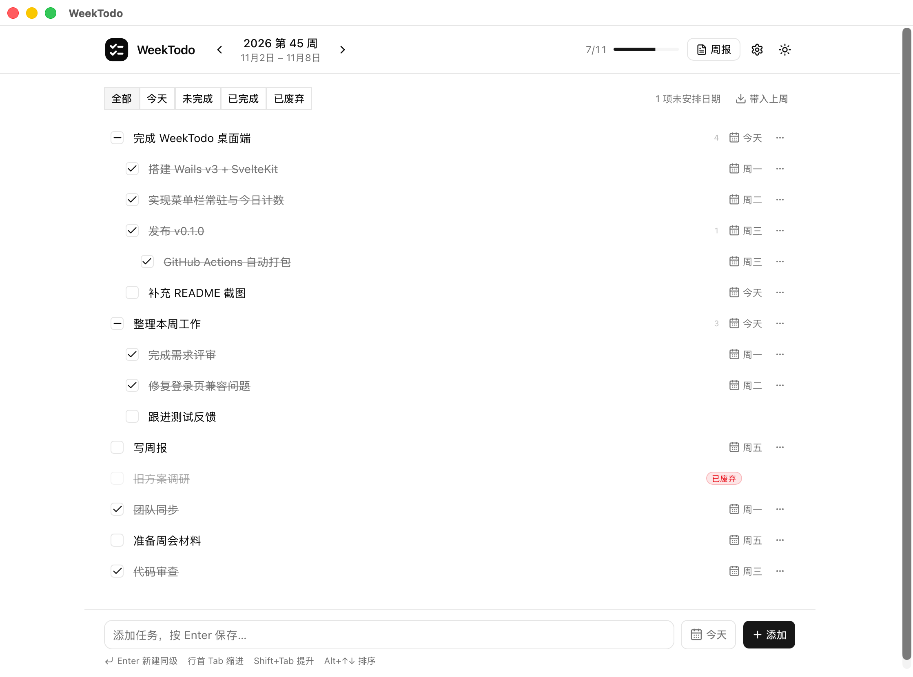

# WeekTodo

一个按周记录待办的桌面应用：层级任务、父子联动、跨周带入、周报总结，数据全部保存在本地 JSON 文件里。



使用 Go + Wails v3 + SvelteKit + shadcn-svelte 构建。关闭窗口后常驻 macOS 菜单栏，图标旁显示今天未完成的任务数。

## 功能

- **分类空间**：工作、开源、生活等分类完全独立，每个分类有自己的周计划、任务、进度和周报；顶部随时切换。
- **按周记录**：周一到周日一个任务清单，任务可以标记具体日期，支持「今天 / 未完成 / 已完成 / 已废弃」筛选。
- **层级任务**：任意嵌套的子任务，行首按 Tab 变成上一条的同级子任务，Shift+Tab 提升。
- **拖拽整理**：拖动任务手柄到另一个任务上即可成为子任务，拖到周列空白处回到根节点；多周视图下可以直接跨周拖拽。
- **父子联动**：子任务全部完成时父任务自动完成；父任务还有未完成子任务时点击复选框会弹确认，确认后一起勾选；取消父任务会连同子任务一起取消。
- **废弃任务**：完成之外还可以废弃，废弃任务不计入完成率和周报，可随时恢复。
- **跨周带入**：一键把上一周未完成的任务复制到本周，保留层级结构，已完成/已废弃的任务不会带入，重复点击不会重复创建。
- **多周视图**：可在 1 周 / 2 周 / 3 周之间切换并记住选择；多周模式下每周独立成列，方便对比，也可以把任务整棵子树移到相邻周。
- **周报**：按完成日期生成精简或完整 Markdown 周报，支持复制和下载；配置任意 OpenAI 兼容接口后可以一键 AI 润色。
- **菜单栏常驻**：窗口打开时支持 Dock / Cmd+Tab；关闭窗口后从 Dock 和 Cmd+Tab 移除，只保留菜单栏图标；左键点击图标恢复窗口，右键快速添加、隐藏或退出。图标旁显示今天未完成数量。
- **中英文界面**：首次启动跟随系统语言，设置里可切换简体中文 / English；主界面、周报、托盘菜单、更新对话框和 AI 提示词同步切换。
- **WebDAV 同步**：在设置里填写 WebDAV 地址、用户名、密码和远端目录，可以测试连接并同步 `weektodo.json`；本地和远端按任务更新时间双向合并，较新的修改优先。支持手动同步，也可以开启自动同步。
- **版本可见**：主界面顶部显示当前版本号，点击直接打开「应用更新」。
- **应用内更新**：检查新版本时优先直连 GitHub，失败后自动切换 gh-proxy；下载校验 SHA256。macOS 安装 DMG，Windows 解压 zip 替换 exe，然后自动重启。菜单栏和设置页都可以检查更新。
- **本地优先**：所有数据保存在 `data.json`，每天首次保存自动备份，保留 14 天。

## WebDAV 同步

1. 打开设置，填写 WebDAV 地址（例如 `https://dav.example.com/remote.php/dav/files/me`）、用户名、密码和远端目录（相对于 WebDAV 地址，开头的 `/` 可省略）。
2. 点「测试连接」确认地址和账号可用。
3. 点「立即同步」把本地 `data.json` 与 `远端目录/weektodo.json` 合并后写回两边。

远端目录在设置中统一显示为 `/weektodo` 这类形式，实际仍相对于 WebDAV 地址拼接。同步默认为手动触发。开启「自动同步」后，本地保存完成约 8 秒后会自动同步，启动时同步一次，并每 5 分钟检查一次远端变化。自动同步只会在应用运行时执行。

同步使用 Basic Auth，并优先对远端目录发 `PROPFIND`；目录不存在时会回退到地址本身，部分服务器不支持 `PROPFIND` 时改用 `OPTIONS`。同步为手动触发，首次同步会自动创建远端目录。

合并按任务 ID 进行：同一任务比较 `updatedAt` / `completedAt` / `droppedAt` / `createdAt`，较新的修改获胜；子任务取并集，所以两端新建的任务都会保留。目前没有删除墓碑，已删除的任务可能从另一端重新出现。

## 多周视图

顶部工具栏可以在 `1 周 / 2 周 / 3 周` 之间切换：

- 1 周：只显示当前浏览周
- 2 周：上一周 + 当前浏览周
- 3 周：上一周 + 当前浏览周 + 下一周

左右箭头每次平移一周，选择会保存在 `settings.json` 的 `weekSpan` 中，重启后保留。窄屏下多周会自动上下排列。

多周模式下，任务「...」菜单里会出现「移到上一周 / 移到下一周」。移动会带走整棵子树、保留层级和完成状态，但会清空日期；目标周没有记录时会自动创建。相邻周在真正写入数据前只是内存占位，不会产生空周记录。

> WebDAV 同步没有删除墓碑。跨周移动相当于在源周删除、在目标周新增，同步后源周可能从远端重新出现该任务。

## 运行

需要 Go 1.27.2+、Node.js 22.17+ 和 Wails v3（仅构建桌面应用时需要）。

```bash
# 浏览器 / 开发服务器
make run
# 打开 http://127.0.0.1:8787

# 构建 macOS 应用
make desktop
# 输出 desktop/build/bin/WeekTodo.app

# 构建 Windows 桌面版（交叉编译）
make windows
# 输出 desktop/build/bin/windows/WeekTodo-desktop-windows-<arch>-<version>.zip

# 构建并运行 iOS Simulator 版（需要 Xcode 和 wails3）
make ios
```

iOS 版完全离线，数据保存在应用沙盒，可通过 WebDAV 与桌面版同步。Simulator 构建使用 `make ios`；App Store 签名、打包和上架流程见 [docs/appstore/README.md](docs/appstore/README.md)。

Windows 版是免安装的便携包，解压后运行 `WeekTodo.exe`。需要 Microsoft Edge WebView2 Runtime（Windows 10/11 通常已安装），数据保存在 `%AppData%\weektodo`。

开发模式（Vite HMR + Go 后端）：

```bash
make dev
# 前端 http://localhost:5173
# 后端 http://127.0.0.1:8787
```

## 快捷键

| 操作 | 效果 |
|---|---|
| Enter | 在当前非空任务后新建同级任务 |
| 空子任务行 Enter | 提升一级，等同 Shift+Tab |
| 行首 Tab | 当前任务变成上一条同级任务的子任务 |
| 行首 Shift+Tab | 当前任务提升一级 |
| Alt+↑ / Alt+↓ | 同一层级内上移 / 下移 |
| 空任务行首 Backspace | 删除当前空任务并聚焦上一条 |
| Esc | 退出当前输入 |

## 菜单栏

- 关闭窗口 = 隐藏窗口，应用继续运行，并从 Dock 和 Cmd+Tab 移除。
- 左键点击菜单栏图标：重新显示窗口，同时恢复 Dock 和 Cmd+Tab。
- 右键菜单可以快速添加任务、隐藏窗口或退出。
- 图标旁的数字是今天未完成的叶子任务数量。
- 窗口打开时使用 `Cmd+Q` 完全退出；隐藏后使用托盘右键「退出 WeekTodo」完全退出。

## 更新

- 菜单栏右键「检查更新…」，或打开「设置 → 应用更新」。
- 检查版本时**优先直接访问 GitHub**；如果 GitHub 请求失败（超时、403、网络不可达等），自动改用 `https://gh-proxy.org/` 代理重试。
- 更新包下载同样优先 GitHub，失败后回退到 gh-proxy。
- 下载完成后用 `SHA256SUMS` / `update.json` 里的 SHA256 校验。
- macOS 挂载 DMG 替换应用并重启；Windows 解压 zip，把正在运行的 exe 改名为 `.old`，写入新版本并重启。自更新要求安装目录可写，因此建议使用免安装 zip。
- 当前为开发版本（`version=dev`）时不执行更新。

可以通过环境变量覆盖更新源，便于调试：

```bash
WEEKTODO_UPDATE_MANIFEST_URL=...
WEEKTODO_UPDATE_MIRROR=https://gh-proxy.org/
WEEKTODO_UPDATE_API=...
```

## 数据

默认目录：`~/.config/weektodo/`（macOS / Linux），Windows 使用 `%AppData%\weektodo\`。

```text
data.json          分类和所有周的任务
settings.json      AI、WebDAV、界面偏好（权限 0600）
backups/           每天首次保存前的自动备份，保留 14 天
```

`data.json` 的 version 2 结构：

```json
{
  "version": 2,
  "categories": [
    { "id": "default", "name": "默认", "color": "#3b82f6" }
  ],
  "weeks": [
    { "id": "2026-W45", "category": "default", "tasks": [] }
  ]
}
```

周由 `(category, id)` 唯一标识，因此同一个 `2026-W45` 可以同时存在于多个分类。旧版 `data.json` 会自动归入「默认」分类。

> version 2 数据结构不兼容旧版 WeekTodo：旧版会把不同分类里的同名周误判为重复周。升级前请保留备份。

`data.json` 是普通 JSON，可以直接备份或版本管理。开发时可以用 `WEEKTODO_DATA_DIR` 覆盖目录。

从旧版本升级时，如果新目录还没有 `data.json`，会自动从 `~/Library/Application Support/WeekTodo/`（旧版 macOS 默认目录）、`~/.weektodo-dev/` 或 `~/.weektodo/` 复制数据、设置和备份，旧目录不会被删除。

## AI 周报

在「设置」里填写：

- Base URL，例如 `https://api.deepseek.com/v1`
- 模型，例如 `deepseek-chat`；填写 Base URL 和 API Key 后可点击「获取列表」直接拉取可用模型
- API Key

接口需要兼容 `POST {baseUrl}/chat/completions`。API Key 只保存在本机 `settings.json`，不会回传给前端，也不会写进日志。AI 润色失败时会保留本地生成的周报。

## 项目结构

```text
cmd/weektodo/         独立 HTTP 服务入口（开发 / 浏览器）
cmd/update-manifest/  发布时生成 update.json
internal/model/       数据结构
internal/store/       JSON 持久化、原子写入、备份
internal/todo/        周计算、状态推导、跨周带入、周报
internal/ai/          OpenAI 兼容接口
internal/update/      版本检查、GitHub/gh-proxy 回退、下载校验、安装重启
internal/server/      HTTP API + 内嵌前端
frontend/             SvelteKit + shadcn-svelte
desktop/              Wails v3 桌面壳（独立 Go module）
scripts/              开发、打包、图标脚本
```

## 发布

推送 `v*` tag 会触发 `.github/workflows/release.yml`，自动构建服务端二进制、universal macOS DMG、Windows amd64 / arm64 便携包、`SHA256SUMS` 和 `update.json`，并发布到 GitHub Releases：

```bash
git tag v0.1.0
git push origin v0.1.0
```

更多开发、测试和发布说明见 [DEVELOP.md](DEVELOP.md)。
